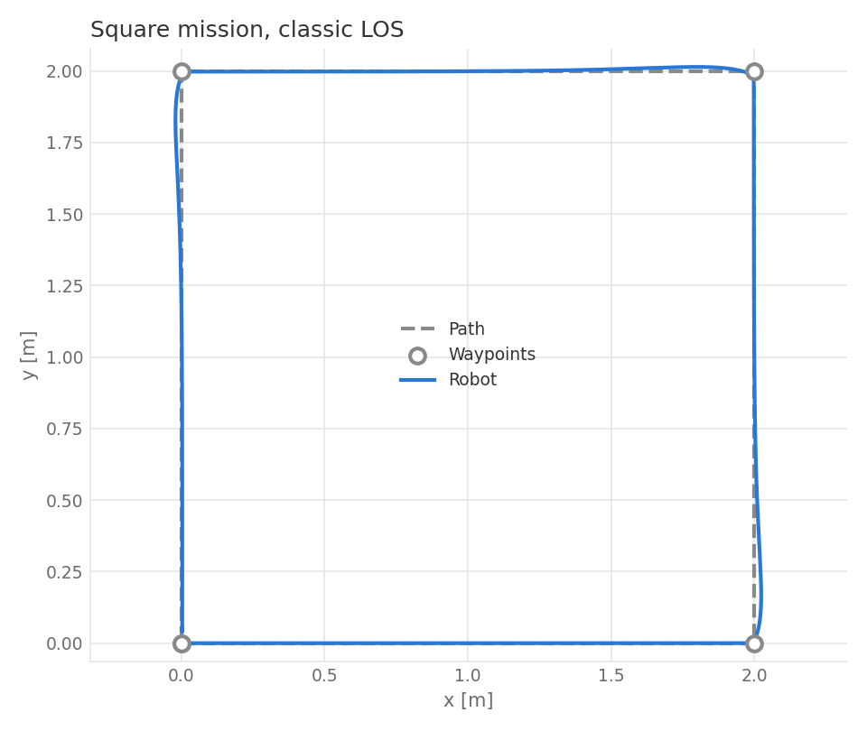
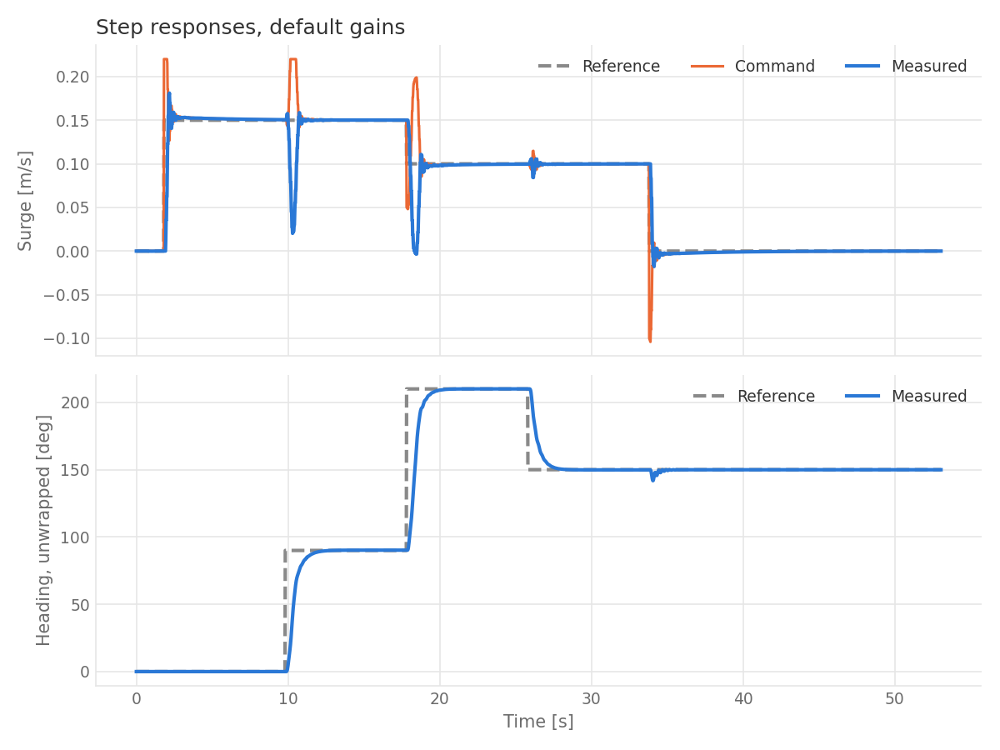
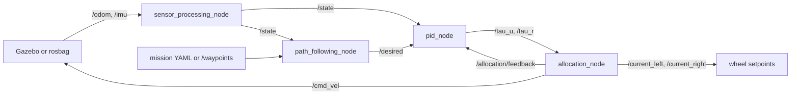
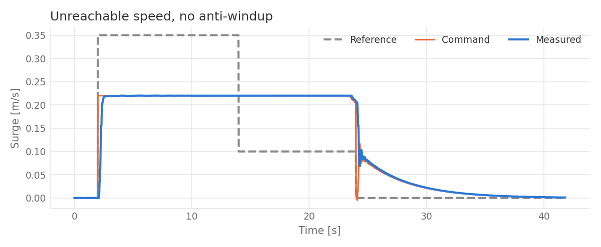
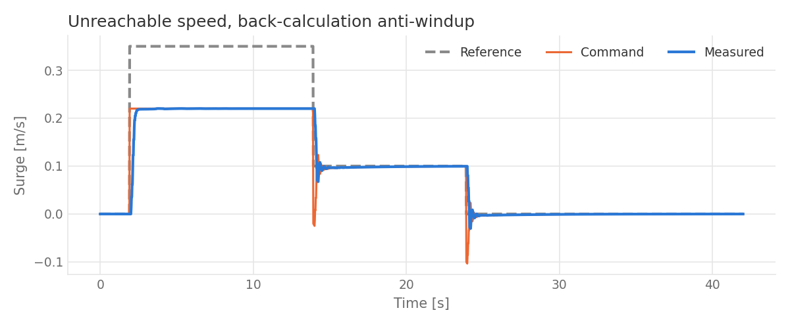

# Surge and heading control for a TurtleBot3

Técnico Solar Boat, Autonomous Systems recruitment, Phase 2: Control.

A ROS 2 Humble pipeline in C++ that regulates the surge velocity and heading of a
TurtleBot3 in Gazebo with two PID loops, and follows waypoints with line-of-sight
guidance. It implements the core work and all the optional features in the statement:
path following, gain scheduling, feedforward and anti-windup.

| Square mission | Step responses |
| --- | --- |
|  |  |

## Quickstart

**On Ubuntu 22.04 or WSL with ROS 2 Humble**, after the steps in the recruitment `Tutorial.txt`:

```bash
git clone <this repository> tsb_ws && cd tsb_ws
rosdep install --from-paths src --ignore-src -y
colcon build --symlink-install
source install/setup.bash
ros2 launch tsb_control sim.launch.py mission:=square gui:=true
```

The robot drives a 2 m square and stops. Leave out `gui:=true` to run headless.

**On any other Linux, with Docker.** No ROS installation is needed:

```bash
make deps          # ROS 2, Gazebo and TurtleBot3 image, once, about 5 minutes
make test          # compile, then run the unit, lint and launch tests
make experiments   # record every run in headless Gazebo, regenerate docs/results
make check         # compare the results against the regression thresholds
make sim MISSION=zigzag
```

## Architecture

The nodes and topics follow Figure 1 of the statement.



| Node | Job |
| --- | --- |
| `sensor_processing_node` | Fuses IMU and odometry into `/state`: position, heading, surge, yaw rate, validity |
| `pid_node` | Surge and heading PID loops, from `/desired` and `/state` to `/tau_u` and `/tau_r` |
| `allocation_node` | Differential-drive allocation with wheel limits, ending in `/cmd_vel` |
| `path_following_node` | Line-of-sight guidance, from waypoints to `/desired` |

Topics, parameters and messages are documented per package:
[tsb_control](src/tsb_control/README.md) and [tsb_control_msgs](src/tsb_control_msgs/README.md).

Figure 1 is drawn for the boat, where `/tau_u` is a force, `/tau_r` a moment, and the
last stage outputs motor currents. A TurtleBot takes velocity commands, so here `/tau_u`
is a surge command in m/s, `/tau_r` a yaw-rate command in rad/s, and `/current_left` and
`/current_right` are wheel-speed setpoints in rad/s. The structure and topic names stay
the same. Moving to the boat would mean changing gains, limits and the allocation model,
and also the feedforward: a boat needs thrust to overcome drag, not just the target speed.

## Usage examples

Set a surge and heading by hand, with the stack running (`sim.launch.py` with no mission):

```bash
ros2 topic pub -r 10 /desired tsb_control_msgs/msg/Reference "{surge: 0.15, heading: 1.57}"
```

Send any list of waypoints as `x,y` pairs (started with `follow:=true`):

```bash
ros2 launch tsb_control sim.launch.py follow:=true
ros2 run tsb_control send_waypoints.py 0.8,0 0.8,0.6
```

Retune a gain while the robot is moving:

```bash
ros2 param set /pid_node heading.kp 3.0
ros2 param set /pid_node anti_windup clamp
```

Start the controllers alone, for example against a real robot or your own simulator:

```bash
ros2 launch tsb_control control.launch.py
ros2 launch tsb_control path_following.launch.py mission:=zigzag
```

Feed a rosbag through the pipeline instead of the simulator. A 20-second sample is included:

```bash
ros2 launch tsb_control bag_replay.launch.py bag:=bags/steps_sensors
```

Record a run and produce its trajectory map, response plots and metrics:

```bash
ros2 launch tsb_control sim.launch.py mission:=square bag:=/tmp/square
ros2 run tsb_control plot_run.py /tmp/square /tmp/figures --title "My run"
```

Launch files and their arguments:

| Launch file | Starts | Arguments |
| --- | --- | --- |
| `control.launch.py` | Sensor, PID, allocation | `use_sim_time`, `variant`, `reference_timeout` |
| `path_following.launch.py` | The above plus path following | `use_sim_time`, `variant`, `mission` |
| `sim.launch.py` | Gazebo, robot and the stack | `gui`, `world`, `x_pose`, `y_pose`, `variant`, `mission`, `follow`, `scenario`, `bag` |
| `bag_replay.launch.py` | The stack on a replayed bag | `bag` |

`variant` layers a file from `config/variants/` over `config/control.yaml`.

## Control design

**The plant.** Fossen's 6-DOF model reduces, with no sway and a planar motion, to surge and
yaw. Gazebo's differential-drive plugin already closes the wheel-velocity loop, so seen from
the controller the surge channel is close to unity gain with a small lag, and the heading
channel is close to an integrator.

**Surge.** `v_cmd = v_d + PID(v_d - v)`. Because the plant follows velocity commands, the
feedforward does nearly all the work and the PI only trims what remains.

**Heading.** `w_cmd = PID(wrap(psi_d - psi))`. The error is wrapped to [-pi, pi] so the robot
always takes the short way. The derivative comes from the gyroscope instead of differencing
the error, which avoids noise amplification and a kick when the setpoint steps.

**Discretisation.** The integral uses the Euler sum from the statement, but stores the term
`Ki * sum(e * dt)` rather than the sum of the error. Changing `Ki` therefore cannot make the
output jump, which is what makes gain scheduling and live retuning bumpless.

### Advanced features

| Feature | What it does | Result |
| --- | --- | --- |
| Feedforward | Commands `v_d` directly | Surge settles in 0.3 to 0.9 s, against 2.4 to 6.2 s without it |
| Anti-windup | Stops the integrator growing during saturation | After an unreachable speed: recovers in 0.36 s, against over 10 s without it |
| Gain scheduling | Heading gains as a function of speed | Heading settles in 1.6 to 1.9 s, against 1.9 to 2.2 s with fixed gains (single runs, so a small difference) |
| Saturation feedback | The allocation tells the PID when it cut a loop | Unit tested; no Gazebo comparison run |
| Integral zone | Integrates heading only near the setpoint | Unit tested; a simple model puts the tail it removes at about 1 degree |

Feedforward, anti-windup and gain scheduling were each compared in Gazebo with the feature
on and off. Each figure comes from one run.

Without anti-windup the integrator reaches 0.81 m/s. The robot then stays at full speed for
the entire 10 s phase in which it should be doing 0.10 m/s:

| No anti-windup | Back-calculation |
| --- | --- |
|  |  |

Two details that matter:

- **The tracking gain defaults to `Kt = Ki / Kp`.** With that value the proportional excess
  and the integration cancel exactly during saturation. A fast `Kt` instead drove the
  integrator negative and caused an undershoot, which `test_closed_loop` caught.
- **Saturation can happen after the PID.** Surge and yaw share the two wheels, and the
  allocation gives yaw priority. So the surge loop can be cut while inside its own limit, and
  `/allocation/feedback` tells it so. The integrator holds in that case instead of tracking,
  because the cut is temporary.

### Path following

`psi_d = alpha + atan(-e / delta)`, with `alpha` the segment direction, `e` the cross-track
error and `delta = 0.4 m` the lookahead. A waypoint counts as reached inside the acceptance
circle, or once it has been passed along the segment. Speed falls with `cos(heading error)^2`
for corners and in proportion to the remaining distance near the goal. An integral term
(`sigma > 0`) is implemented for steady drift, such as a current on a boat, and is off by
default because a TurtleBot has none.

| Mission | Cross-track RMS | Cross-track max | Stops from goal |
| --- | --- | --- | --- |
| Square | 0.9 cm | 4.9 cm | 5.8 cm |
| Zigzag | 1.3 cm | 4.7 cm | 5.7 cm |

Cross-track figures cover the straight parts, more than 0.5 m before each waypoint, since
corners are transients by design. The robot reaches the 5 cm acceptance radius and brakes,
then drifts back slightly as a small surge integral term decays, ending about 6 cm away.

### Safety

Every layer stops the robot if the layer before it goes quiet: stale sensors mark `/state`
invalid, the PID then commands zero and clears its integrators, and the allocation has its
own watchdog on the commands. `test_pipeline` checks this on the running nodes.

## Tests

`make test` runs 91 test cases: unit tests for every algorithm, closed-loop tests against simple
plant models, a launch test of the real nodes with fake sensors, and the ROS linters
(`cpplint`, `uncrustify`, `flake8`, `pep257`, `lint_cmake`, `xmllint`). The `cppcheck` linter
reports 15 more as skipped, since ROS 2 Humble disables it for the version in Ubuntu 22.04.
`make check` asserts the path-following and anti-windup results on the recorded runs, with
some margin. CI runs the tests on every push and pull request, plus four of the eight Gazebo
runs: the square mission, the step responses, and anti-windup on and off.

## Problems found while integrating

- **The robot fell forever with its wheels spinning.** With `GAZEBO_MODEL_DATABASE_URI=""`,
  `model://ground_plane` may not resolve, and the world has no floor. `worlds/flat.world`
  defines the plane inline, so it has no dependency on the model path.
- **The 50 Hz loops ran at 10 Hz.** Gazebo publishes `/clock` at 10 Hz by default, and timers
  on simulated time only fire when the clock advances. `config/gazebo.yaml` raises it to 200 Hz.
- **Parallel runs interfered with each other.** Containers on the same Docker bridge discover
  each other over DDS, so robots obeyed each other's commands. Each run gets its own
  `ROS_DOMAIN_ID`.

## Repository layout

| Path | Contents |
| --- | --- |
| `src/tsb_control/` | Nodes, ROS-free algorithm headers, launch files, YAML, worlds, tests |
| `src/tsb_control_msgs/` | Custom messages |
| `experiments/` | Runs all experiments, regenerates figures, checks thresholds |
| `docs/results/` | Figures and metrics generated from the recorded runs |
| `bags/` | Sample rosbag for replay |
| `docker/` | ROS 2 Humble, Gazebo and TurtleBot3 image |

Gain tuning was not required by the statement. The defaults are a reasonable starting point,
not an optimum.

AI assistance was used throughout this project, including for writing the code and this
documentation.
